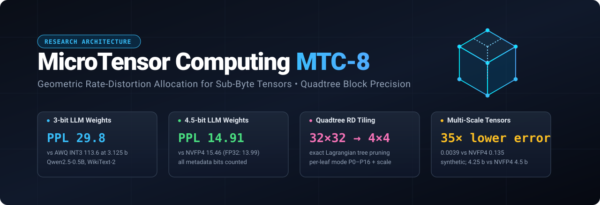
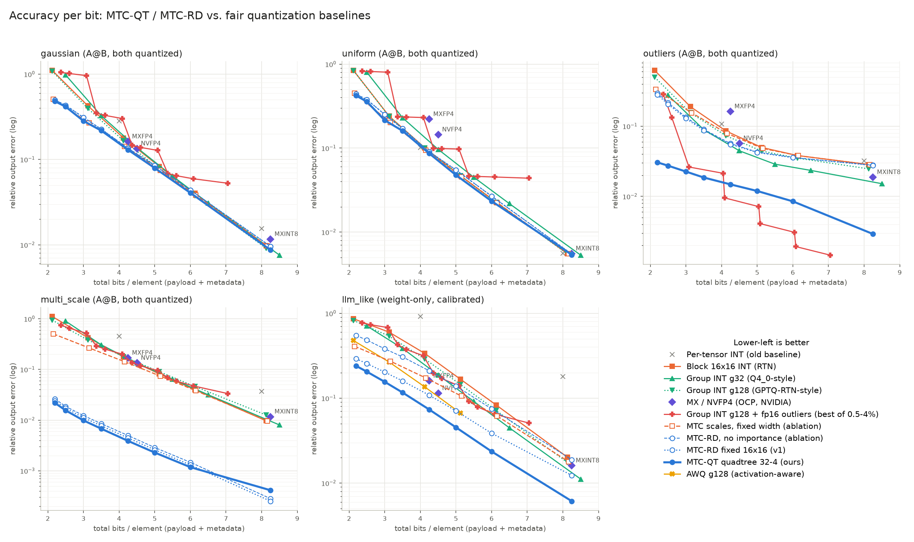

<p align="center">
  
</p>

# MicroTensor Computing (MTC-8)

> **Notice:** *This repository is ongoing research into tensor representations with geometric structure. It explores tensors partitioned into micro-blocks, each with its own numerical precision, and hierarchical tiling, as an alternative to uniform fixed-precision storage.*

[](https://www.python.org/downloads/)
[](https://numba.pydata.org/)
[](LICENSE)
[](https://github.com/Sharexi/TensorPack)

---

## Headline Result: Rate-Distortion Geometry for LLM Weight Quantization

The core MTC idea is that **the geometry of a tensor should decide where the bits go**. Its strongest form here is **MTC-QT**:

- A quadtree tiles each weight matrix with blocks of 32×32 down to 4×4.
- Every leaf picks its own precision from {P0, P2, P3, P4, P5, P6, P8, P16} and its own bf16 scale.
- An exact Lagrangian rate-distortion optimization chooses the tiling and precisions, using an activation-aware (diagonal-Hessian) distortion.

**Qwen2.5-0.5B, WikiText-2 perplexity (lower is better; FP32 = 13.99).** All methods quantize weights only and are evaluated on the same 24,576 test tokens. *Bits/weight* counts **everything stored**: payload, scales, mode bytes and split flags.

| Bits / weight | Best baseline at that budget | MTC-RD (fixed 16×16) | **MTC-QT (quadtree)** |
| :--- | :--- | :--- | :--- |
| 2.5 | (none) | 543 | **267** |
| 3.125 | AWQ g128 INT3: 113.6 (RTN: 202.6) | 84.9 | **29.8** |
| 4.125 | AWQ g128 INT4: 18.91 (RTN: 19.31) | 16.56 | **15.70** |
| 4.25 | MXFP4: 17.42 | 15.94 | **15.33** |
| 4.5 | NVFP4: 15.46 (RTN g32: 16.55) | 15.26 | **14.91** |

- At **3.1 bits**, MTC-QT reaches perplexity 29.8, against 113.6 for AWQ at the same size.
- At **4.5 bits**, it is within 0.92 perplexity of FP32 and beats NVFP4.
- **Activation awareness is essential.** Without it, MTC-RD degrades from 84.9 to 902.8 at 3.125 b and from 16.6 to 22.5 at 4.125 b.

Full table: [`results/llm_ppl.md`](results/llm_ppl.md). Reproduce with `python -m mtc.benchmarks.benchmark_llm` (CPU, about 75 min; downloads the model and dataset from Hugging Face).

### Accuracy per bit against fair baselines (synthetic matrices)

<p align="center"></p>

The baselines are block and group INT RTN (g32 / g128), MXFP4, MXINT8, NVFP4, g128 with an fp16 outlier list (swept over 0.5–4%, best point reported), and AWQ-style scaling. Every curve is plotted against total bits including metadata. Numbers: [`results/pareto.md`](results/pareto.md). Reproduce with `python -m mtc.benchmarks.benchmark_pareto`.

Relative output error at 4.25 bits:

| Scenario | MTC-QT | Best baseline |
| :--- | :--- | :--- |
| LLM-like (heavy-tailed weights, outlier activation channels) | **0.074** | NVFP4 0.114 (at 4.5 b), AWQ 0.127 |
| Multi-scale (block energy spans 10⁻³–10²) | **0.0039** | NVFP4 0.135 (at 4.5 b) |
| Gaussian / uniform (no structure to exploit) | **0.130 / 0.086** | g128 0.155 / 0.094 (≈ tie expected) |
| Isolated outliers (2% at ±25) | 0.0148 | **g128 + fp16 outliers 0.0091** |

**Where it loses:** on isolated scalar outliers, a sparse outlier list beats block tiling from about 3 bits up. A hybrid (quadtree plus sparse outlier side list) is the obvious next step.

---

## 60-Second Quickstart

```python
import numpy as np
from mtc.core.allocation import rd_allocate_pair
from mtc.core.quadtree import QuadtreeRD
from mtc.kernels.gemm import MTCMatrix, mtc_gemm

W = np.random.randn(1024, 1024).astype(np.float32)        # (in_features, out_features)
X_cal = np.random.randn(256, 1024).astype(np.float32)      # calibration activations
h = (X_cal ** 2).mean(axis=0)                             # diagonal-Hessian importance per input row

# 1. Variable-block-size (quadtree) RD allocation at an exact total-bit budget
qt = QuadtreeRD(W, h, sizes=(32, 16, 8, 4))                # one scale search, many budgets
alloc = qt.select(3.125)                                   # bits/weight incl. all metadata
print(alloc.bits_per_element, alloc.leaf_area_fraction())
W_hat = alloc.dequant

# 2. Fixed 16x16 RD allocation of both GEMM operands, packed into the arena and run on the Numba kernel
a, b = rd_allocate_pair(X_cal, W, 4.25)                   # each operand weighted by the other's energy
A_mtc = MTCMatrix.from_allocation(X_cal, a.modes, a.scales, 16)   # P0..P16 blocks, bit-exact
W_mtc = MTCMatrix.from_allocation(W, b.modes, b.scales, 16)
Y = mtc_gemm(A_mtc, W_mtc)                                # == a.dequant @ b.dequant (to ~1e-7)
```

---

## 1. How MTC-RD / MTC-QT Work

**Distortion.** For a linear layer $Y = XW$, the output error from a weight perturbation is approximately $\sum_k h_k \|\Delta W_{k,:}\|^2$, where $h_k = \mathbb{E}[x_k^2]$ is measured on calibration data. Weight rows that see large activations matter more. Because this distortion is **additive over disjoint blocks**, the allocation problem is separable.

**Candidates.** For each block $b$ and each mode $m \in \{0, 2, 3, 4, 5, 6, 8, 16\}$ bits, a parallel Numba kernel searches the MSE-optimal clipping scale (both signs of the asymmetric integer grid, optionally rounded to bf16). This gives a distortion $D_{b,m}$ at a rate $R_{b,m}$. A dense mode lattice matters: mixing only 4- and 8-bit blocks loses to plain 6-bit codes.

**Fixed tiles (MTC-RD).** Minimize $\sum_b D_{b,m_b} + \lambda R_{b,m_b}$ with bisection on $\lambda$, then fill the remaining budget greedily. The total-bit budget is met exactly.

**Quadtree (MTC-QT).** Every node is either a leaf with its own (mode, scale) or splits into four children. Leaves pay payload plus 16-bit scale plus 8-bit mode; internal decisions pay 1 split-flag bit. For each $\lambda$, bottom-up pruning solves the problem **exactly**:

$$
J(\text{node}) = \min\Big(J_{\text{leaf}}(\text{node}),\; \sum_{\text{children}} J(\text{child})\Big) + \lambda \cdot 1\,\text{bit}
$$

This is the coding-tree decision used in HEVC/VVC video coding, applied to tensor storage. Smooth regions get large, cheap tiles. Regions with outlier rows or columns get small tiles with their own scales. Near-silent regions drop to P0 or P2.

**Storage format.** P3/P5/P6 blocks are stored as little-endian bitstreams; P0 blocks occupy zero payload bytes. Block offsets come from a prefix sum and are not stored. `MTCMatrix.from_allocation` produces the packed arena. Tests check that the arena size equals the accounted payload bits and that the Numba GEMM reproduces the simulated quantization to about 1e-7.

---

## 2. Status of Earlier Claims (Corrected)

An external review of the first version of this repository found that several headline numbers came from weak baselines. They are corrected here:

| Earlier claim | Status |
| :--- | :--- |
| "50× error reduction over INT4" | That comparison used **per-tensor** INT4. Against block or group INT at matched bits, the original ε-negotiation mostly bought accuracy by spending 12–16 bits. The RD allocator above replaces it and is evaluated at matched total bits. |
| "2.5× faster than INT8 GEMM" | The INT8 baseline used a cache-hostile loop order, and the MTC kernel computes in FP32 internally. FP32 BLAS (≈230 GFLOPS) is far faster than the MTC kernel (≈35–38 GFLOPS) on this CPU. **No speed advantage is claimed.** The contribution is accuracy per stored bit, i.e. memory and bandwidth. |
| "MTC-Adaptive inference 5.1× faster than INT8" | `LinearMTCAdaptive.forward` runs BLAS on cached dequantized weights, so it measures FP32 BLAS speed, not the packed format. |
| "Ternary QAT converges" | The final loss of 2.754 is at chance level for 16 classes (ln 16 = 2.773). The ternary model did not learn. |
| "5 trits/byte, zero multipliers" | The 1.6 bits/trit packing is correct but already standard (e.g. llama.cpp `TQ1_0`). "Zero multipliers" is not a speed advantage in software: the ternary path is about 27× slower than FP32. |
| RNS "carry-free" channels, p-adic ultrametrics | Mathematically correct demonstrations. They are not connected to any measured efficiency gain and are kept as exploratory modules. |
| 3D octree "97.9% memory reduction" | Valid for the synthetic mostly-empty volume shown. A sparse-volume format such as OpenVDB is the relevant comparison and has not been benchmarked. |

The legacy benchmarks (`benchmark_runner.py`, `benchmark_inference.py`, `benchmark_training.py`, `benchmark_geometric.py`) are kept for reproducibility, but their output should be read with the caveats above.

---

## 3. Architecture

### Layer 1: Elementary storage
Blocks live in a contiguous `uint8` memory arena. Modes:
- **P0**: dropped block, zero payload.
- **P2 / P4 / P8 / P16**: byte-aligned packing.
- **P3 / P5 / P6**: bitstreams.

Each block also carries a scale (fp32 or bf16) and a mode byte.

### Layer 2: Structural pointer hierarchy
`PointerTensor` organizes blocks as a 2×2 hierarchy whose entries are arena offsets or operation nodes (`OP_MATMUL`, `OP_ADD`, `OP_TRANSPOSE`). This enables zero-copy transposition, quadtree composition and lazy DAG evaluation. A packed execution kernel for MTC-QT leaves is the natural next use of this layer.

### Layer 3: Precision allocation
- **Original**: per-block-pair "joint negotiation" against a Frobenius error bound (`mtc/core/precision.py`).
- **Current**: rate-distortion allocation (`mtc/core/allocation.py`, `mtc/core/quadtree.py`), described in section 1.

### The elementary multiplication primitive
Blocks are multiplied as integer tiles and rescaled once per block product:

$$
C_{ij} \leftarrow C_{ij} + (\text{scale}_A \cdot \text{scale}_B) \sum_k A_{ik} B_{kj}
$$

The current Numba kernel accumulates in FP32 and skips any block product involving a P0 block.

---

## 4. Exploratory Modules

- **3D micro-cubes and octrees** (`mtc/spatial3d`):
  - 2×2×2 voxel cubes (P1 spin packing 8 voxels per byte).
  - Octrees with vacuum pruning.
  - 3D convolution and trilinear contractions.
- **Number-theoretic arithmetic** (`mtc/primes`):
  - Residue Number System over coprime moduli with CRT reconstruction.
  - Balanced ternary $\mathbb{F}_3$ with 5 trits/byte packing and add/subtract-only GEMM.
  - $p$-adic valuations and ultrametric tree distance.
- **Neural network layers** (`mtc/nn`): FP32, INT8, MTC-Adaptive and ternary (BitNet-style) linear layers, plus a small MLP. See section 2 for the caveats.

---

## 5. Repository Structure

```
mtc/
├── core/
│   ├── types.py            # PrecisionMode (P0, P2, P3, P4, P5, P6, P8, P16), OpCode
│   ├── arena.py            # Contiguous uint8 memory arena
│   ├── packing.py          # Numba bit-packing & unpacking routines
│   ├── microtensor.py      # Elementary MicroTensor & BlockDescriptor
│   ├── pointer_tensor.py   # PointerTensor hierarchy, DAG operations, lazy evaluate
│   ├── precision.py        # Original joint precision negotiation (legacy)
│   ├── allocation.py       # MTC-RD: activation-aware rate-distortion block allocation
│   └── quadtree.py         # MTC-QT: variable-block-size (quadtree) RD allocation
├── kernels/
│   ├── reference.py        # FP32 BLAS reference & error metrics
│   ├── mtmul.py            # Elementary 2x2 MTMUL kernel
│   └── gemm.py             # Macrotiled GEMM over the arena (P0..P16, bitstream modes)
├── baselines/
│   ├── formats.py          # Block/group INT, MXFP4, MXINT8, NVFP4, outlier-split, AWQ-style
│   ├── int8_gemm.py        # Legacy per-tensor INT8 baseline
│   └── int4_gemm.py        # Legacy per-tensor INT4 baseline
├── benchmarks/
│   ├── benchmark_llm.py       # Real-LLM perplexity (Qwen2.5-0.5B, WikiText-2)
│   ├── benchmark_pareto.py    # Accuracy-per-bit Pareto curves vs fair baselines
│   ├── benchmark_runner.py    # Legacy multi-distribution benchmark
│   ├── benchmark_geometric.py # 3D octree and RNS benchmarks
│   ├── benchmark_inference.py # Legacy NN inference benchmark
│   ├── benchmark_training.py  # Legacy NN QAT benchmark
│   └── report.py              # Markdown report generator
├── nn/                     # Linear layers and DeepMLP
├── spatial3d/              # Micro-cubes, octrees, 3D convolution
├── primes/                 # RNS, balanced ternary, p-adic
└── experiments/            # Precision and error-accumulation analyses
results/                    # Generated benchmark tables, JSON and figures
```

---

## 6. Getting Started

```bash
git clone https://github.com/Sharexi/TensorPack.git
cd TensorPack
pip install -r requirements.txt
python -m pytest tests/                       # 57 tests
python -m mtc.benchmarks.benchmark_pareto     # ~1 min  -> results/pareto.*
python -m mtc.benchmarks.benchmark_llm        # ~75 min -> results/llm_ppl.* (needs torch, transformers, datasets)
python reproduce.py                           # legacy suite
```

---

## 7. Limitations and Next Steps

- **Simulation and execution.** The perplexity results are weight-only and use round-to-nearest within each block. The packed arena format and Numba kernel execute fixed 16×16 allocations. MTC-QT stores an exact, compact allocation, but it has no packed execution kernel yet.
- **Scale of evaluation.** One 0.5B model on one dataset. Larger models (1–8B), zero-shot tasks, and GPTQ-style error compensation (which is orthogonal and could be combined with RD allocation) are still to be done.
- **No speed claims.** Planned work:
  - a packed quadtree kernel;
  - block-sparse P0 skipping at scale;
  - a quadtree with a sparse outlier list;
  - rectangular (multi-type-tree) splits;
  - lattice vector quantization inside blocks.

---

## Citation

```bibtex
@software{quaranta2026mtc,
  title  = {MicroTensor Computing (MTC-8): Geometric Rate-Distortion Allocation for Sub-Byte Tensors},
  author = {Quaranta, Aniello},
  year   = {2026},
  url    = {https://github.com/Sharexi/TensorPack}
}
```

## Author & Acknowledgments

- **Author**: **Aniello Quaranta** ([Sharexi](https://github.com/Sharexi)). Conceptual formulation, mathematical architecture, geometric foundations and research direction.
- **AI Pair Programming Disclosure**:
  - The original implementation was developed with Google DeepMind's Gemini / Antigravity as an interactive AI pair programmer.
  - The rate-distortion allocation (MTC-RD / MTC-QT), the fair-baseline suite, the LLM evaluation and the corrections in section 2 were developed with Anthropic's Claude.
  - All AI-assisted work was done under the author's direction and verification.

## License
MIT License. Copyright (c) 2026 Aniello Quaranta. See [LICENSE](LICENSE) for details.
