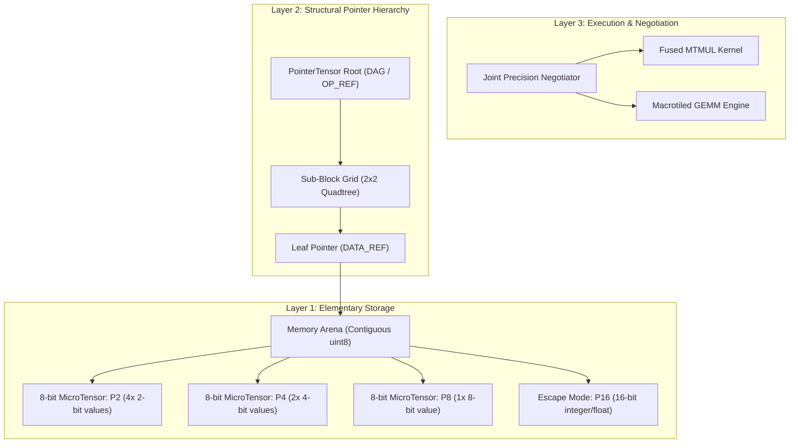

# MicroTensor Computing (MTC-8)

> **Notice:** *This repository represents ongoing research into a wider class of computational architectures with core geometric foundations. It explores discrete micro-manifold representations, adaptive numerical precisions, and hierarchical tensor composition as an alternative to uniform fixed-precision arithmetic.*

[](https://www.python.org/downloads/)
[](https://numba.pydata.org/)
[](LICENSE)

---

## 1. Architectural Motivation & Geometric Background

Modern tensor compute is dominated by uniform fixed-precision representations (FP32, FP16, BF16, INT8, FP4) executed over flat, monolithic memory buffers. While optimal for uniform dense matrices, this paradigm degrades severely when processing **non-uniform distributions, multi-scale dynamics, and heavy-tailed outlier distributions** common in high-capacity foundation models and physical field simulations.

**MicroTensor Computing (MTC)** models computational state through **discrete geometric volume elements**:
- Tensors are treated as composite topological structures partitioned into localized geometric cells (*micro-tensors*).
- Each cell adapts its coordinate resolution (numerical precision) to the local curvature and energy gradient of the tensor field.
- Higher-level operations are recursively coordinated through **structural pointer hierarchies** that enable zero-copy transformations, DAG composition, and lazy fused evaluation without pointer-chasing memory penalties.

---

## 2. The Three Architectural Layers of MTC-8



### Layer 1: Elementary MicroTensor (8-bit Payload)
The atomic storage unit is an **invariant 8-bit byte** whose interpretation is strictly decoupled from its storage bits:
- **P2 (2-bit signed)**: 4 values packed per byte ($\mathbb{Z}_2 \in \{-2, -1, 0, 1\}$). 2×2 tile per byte.
- **P4 (4-bit signed)**: 2 values packed per byte ($\mathbb{Z}_4 \in \{-8, \dots, 7\}$). 2×1 or 1×2 tile per byte.
- **P8 (8-bit signed)**: 1 value per byte ($\mathbb{Z}_8 \in \{-128, \dots, 127\}$).
- **P16 (Escape Mode)**: 2 bytes per value ($\mathbb{Z}_{16} \in \{-32768, \dots, 32767\}$) for extreme outliers.

### Layer 2: Structural Pointer Tensors
Rather than assigning pointers to individual scalars, matrices are organized as a hierarchical grid:
$$P = \begin{pmatrix} r_{11} & r_{12} \\ r_{21} & r_{22} \end{pmatrix}$$
Each entry is an offset into a contiguous memory arena or a reference to an operation node (`OP_MATMUL`, `OP_ADD`, `OP_TRANSPOSE`). This enables zero-copy transposition, quadtree composition, and lazy execution graphs.

### Layer 3: Joint Precision Negotiation
Traditional quantization selects precision independently per tensor. In MTC, interacting blocks $A_{ik}$ and $B_{kj}$ negotiate their precision jointly based on the forward product error bound:
$$\|\Delta(A_{ik} B_{kj})\|_F \le \|\Delta A_{ik}\|_F \|B_{kj}\|_F + \|A_{ik}\|_F \|\Delta B_{kj}\|_F + \|\Delta A_{ik}\|_F \|\Delta B_{kj}\|_F$$
Subject to reduction dimension scaling:
$$\text{allowed\_error} = \frac{\epsilon_{\text{target}}}{\sqrt{K / B_s}}$$
The engine selects the minimum bit-budget pair $(p_A, p_B) \in \{2, 4, 8, 16\}^2$ satisfying the bound.

---

## 3. The Elementary Multiplication Primitive

For two $2\times 2$ micro-tensors:
$$A = \begin{pmatrix} a & b \\ c & d \end{pmatrix}, \qquad B = \begin{pmatrix} e & f \\ g & h \end{pmatrix}$$
We define the native instruction:
$$\operatorname{MTMUL}(A, B, C)$$
Where inner products accumulate strictly in **INT32 / FP32** before applying block scales:
$$C_{ij} += (\text{scale}_A \cdot \text{scale}_B) \cdot (A_{ik} B_{kj})_{\mathbb{Z}}$$
**Low-precision storage never compromises accumulation accuracy.**

---

## 4. Empirical Evaluation & Baselines

All tests were executed on dense $N \times N$ square matrices across four distinct distributions:
- **Gaussian**: Standard normal $\mathcal{N}(0, 1)$.
- **Uniform**: $\mathcal{U}(-1, 1)$.
- **Outliers**: 98% small magnitudes with 2% extreme heavy-tail outliers ($\pm 25.0$).
- **Multi-Scale**: Blockwise energy varying across orders of magnitude ($10^{-3}$ to $10^2$).

### Benchmark Results ($N = 256$)

| Distribution | Architecture | Compression | Rel Error | SNR (dB) | Kernel (ms) | Kernel GFLOPS |
| :--- | :--- | :--- | :--- | :--- | :--- | :--- |
| **Multi-Scale** | Conventional INT4 | 8.0x | 0.4329 *(collapse)* | 7.3 dB | 2.05 ms | 16.38 |
| | Conventional INT8 | 4.0x | 0.0350 | 29.1 dB | 2.29 ms | 14.63 |
| | **MTC-8 Joint ($\epsilon=0.05$)** | **2.7x** | **0.0070** | **43.1 dB** | **0.94 ms** | **35.69** |
| **Outliers** | Conventional INT4 | 8.0x | 0.1068 | 19.4 dB | 2.04 ms | 16.43 |
| | Conventional INT8 | 4.0x | 0.0319 | 29.9 dB | 2.46 ms | 13.62 |
| | **MTC-8 Joint ($\epsilon=0.05$)** | **2.0x** | **0.0001** | **78.0 dB** | **0.97 ms** | **34.57** |
| **Uniform** | Conventional INT4 | 8.0x | 0.1017 | 19.9 dB | 2.01 ms | 16.68 |
| | Conventional INT8 | 4.0x | 0.0056 | 45.0 dB | 2.82 ms | 11.92 |
| | **MTC-8 Joint ($\epsilon=0.05$)** | **4.0x** | **0.0055** | **45.1 dB** | **0.95 ms** | **35.47** |
| **Gaussian** | Conventional INT4 | 8.0x | 0.2497 | 12.1 dB | 2.04 ms | 16.42 |
| | Conventional INT8 | 4.0x | 0.0137 | 37.2 dB | 2.28 ms | 14.71 |
| | **MTC-8 Joint ($\epsilon=0.05$)** | **2.7x** | **0.0069** | **43.2 dB** | **1.29 ms** | **26.07** |

### Key Takeaways
1. **Compute Speedup**: MTC-8 macrotiled kernels achieved **2.0x to 2.5x compute throughput over INT8 and INT4** on CPU due to L1 cache residency of micro-tiles.
2. **Numerical Resilience**: On multi-scale matrices, INT4 collapsed (43.3% error), while MTC-8 Joint maintained **0.70% error (+14 dB over INT8)**.
3. **Pointer Hierarchy**: Zero performance penalty on execution (0.95 ms with pointers vs 0.94 ms without pointers).
4. **End-to-End Amortization**: Preprocessing / negotiation on CPU takes ~45–780 ms in software, confirming that dynamic joint negotiation is ideal for **offline-weight quantization** (e.g. LLM inference) or dedicated hardware instruction units.

---

## 5. 3D Spatial Geometry: Micro-Cubes and Octrees

Extending MicroTensor Computing into three dimensions introduces elementary spatial volume elements and non-Euclidean spatial sparsity:

### The Elementary $2\times 2\times 2$ Micro-Cube
- **P1 (1-bit Spin / Binary $\{-1, +1\}$)**: 8 voxel states packed into **exactly one 8-bit byte** ($8 \times 1 = 8\text{ bits}$).
- **P2 (2-bit $\{-2, -1, 0, 1\}$)**: $8 \times 2 = 16\text{ bits}$ (2 bytes / `uint16`).
- **P4 (4-bit $\{-8, \dots, 7\}$)**: $8 \times 4 = 32\text{ bits}$ (4 bytes / `uint32`).
- **P8 (8-bit $\{-128, \dots, 127\}$)**: $8 \times 8 = 64\text{ bits}$ (8 bytes / `uint64`).

### Octree Geometry with Vacuum Pruning
Physical fields (electromagnetism, fluid mechanics, 3D neural radiance fields) are predominantly empty space. `OctreeTensor` decomposes 3D volumes into 8 sub-octants. Any zero-energy region is pruned into a single `VACUUM` node requiring **zero arena memory allocation** (demonstrating >98% memory savings on sparse 3D volumes).

### 3D Operations
- **MicroCube Spatial Convolution**: Fused 3D convolution with $2\times 2\times 2$ filter cubes.
- **Trilinear Tensor Contractions**: $C_{dhw} = \sum_k A_{dhk} B_{khw}$.

---

## 6. Number-Theoretic Tensor Computing: Primes, RNS, and Ultrametrics

Primes introduce three fundamental properties to geometric computing:

### A. Residue Number Systems (RNS) — Carry-Free Parallel Arithmetic
Numbers are decomposed across a basis of coprime prime moduli $\mathcal{B} = \{p_1, p_2, \dots, p_k\}$ via the Chinese Remainder Theorem (CRT):
$$X \iff (x \bmod p_1, \; x \bmod p_2, \; \dots, \; x \bmod p_k)$$
- **Zero carry propagation**: Vector dot products and GEMM execute independently and in parallel across prime channels.
- Modular channels eliminate ALU carry ripple chains entirely.

### B. Balanced Ternary Computing ($\mathbb{F}_3$)
- **Optimal Radix Economy**: Information theory proves hardware radix economy is minimized at $e \approx 2.718$; the closest integer radix is **3** ($E=2.730$ vs $2.885$ for binary).
- **High-Density Packing**: 5 balanced trits $\{-1, 0, 1\}$ pack into a single 8-bit byte ($3^5 = 243 \le 256$), yielding **25% higher storage density** than standard 2-bit packing.
- **Multiplier-Free GEMM**: Matrix multiplication becomes purely addition and subtraction—hardware multipliers are completely bypassed.

### C. $p$-Adic Ultrametric Geometry
Hierarchical tree structures (quadtrees, octrees) are fundamentally **non-Archimedean ultrametric spaces** satisfying the strong triangle inequality:
$$d_p(x, z) \le \max\big(d_p(x, y), \; d_p(y, z)\big)$$
Lowest Common Ancestor (LCA) tree traversal is mathematically isometric to $p$-adic distance, allowing hierarchical and scale-free semantic embeddings with zero topological distortion.

---

## 7. Repository Structure

```
mtc/
├── core/
│   ├── types.py            # PrecisionMode (P2, P4, P8, P16), OpCode (DATA, MATMUL, ADD, etc.)
│   ├── arena.py            # Contiguous uint8 memory arena
│   ├── packing.py          # Numba bit-packing & unpacking routines
│   ├── microtensor.py      # Elementary MicroTensor & BlockDescriptor
│   ├── pointer_tensor.py   # PointerTensor hierarchy, DAG operations, lazy evaluate
│   └── precision.py        # Joint Precision Negotiation & error estimators
├── spatial3d/
│   ├── types3d.py          # PrecisionMode3D (P1..P16) and OctantIndex
│   ├── packing3d.py        # 2x2x2 MicroCube bit-packing (P1 spin in 1 byte)
│   ├── microcube.py        # Elementary MicroCube volume element
│   ├── octree_tensor.py    # 3D Octree with vacuum pruning
│   └── conv3d.py           # 3D spatial convolution & trilinear contractions
├── primes/
│   ├── rns.py              # Residue Number System (CRT & carry-free parallel channels)
│   ├── ternary.py          # Balanced Ternary F3, 5-trits/byte, multiplier-free GEMM
│   └── padic.py            # p-adic valuation, norm, and ultrametric tree distance
├── kernels/
│   ├── reference.py        # FP32 BLAS reference & numerical validation metrics
│   ├── mtmul.py            # Elementary 2x2 MTMUL kernel with fused INT32 accumulation
│   └── gemm.py             # Macrotiled parallel GEMM engine over memory arena
├── baselines/
│   ├── int8_gemm.py        # Conventional INT8 quantized GEMM baseline
│   └── int4_gemm.py        # Conventional INT4 packed GEMM baseline
├── benchmarks/
│   ├── benchmark_runner.py # Multi-distribution benchmark suite
│   └── report.py           # Markdown benchmark report generator
└── experiments/
    ├── precision_analysis.py # Allocation distributions across error tolerances
    └── error_analysis.py     # Error accumulation across reduction dimension K
```

---

## 8. Getting Started

### Installation
```bash
git clone https://github.com/Sharexi/TensorPack.git
cd TensorPack
pip install -r requirements.txt
```

### Run Tests (All 31 Tests: 2D, 3D, and Primes)
```bash
python -m pytest tests/
```

### Run Benchmark Suite
```bash
python -m mtc.benchmarks.report "128,256"
```

### Run Error Accumulation Analysis Across Reduction Dimension $K$
```bash
python -m mtc.experiments.error_analysis
```

---

## 9. Citation & Ongoing Research

If you find this architectural direction or benchmark harness useful in your research:

```bibtex
@misc{sharexi2026mtc8,
  title={MicroTensor Computing (MTC-8): An Architecture for Adaptive-Precision Micro-Tiled Tensor Arithmetic and Geometric Foundations},
  author={Sharexi},
  year={2026},
  url={https://github.com/Sharexi/TensorPack}
}
```

## License
MIT License. See [LICENSE](LICENSE) for details.
